<p align="center">
  
</p>

<h1 align="center">SquirrelDisk</h1>

<p align="center">
  See what's using your disk space, and clean it up safely.<br>
  For macOS, Windows and Linux (x86_64 and arm64, including Raspberry Pi). Free, and it makes no network requests of its own.
</p>

<p align="center">
  <a href="https://github.com/Randy420Marsh/squirreldisk/releases/latest"></a>
  <a href="https://github.com/Randy420Marsh/squirreldisk/releases"></a>
  <a href="https://github.com/Randy420Marsh/squirreldisk/actions/workflows/ci.yml"></a>
  
  <a href="LICENSE"></a>
</p>

> [!IMPORTANT]
> **This is the Randy420Marsh fork of [SquirrelDisk](https://github.com/adileo/squirreldisk), a no-network build.** It never connects anywhere by itself: no sponsor banner, no usage counts, no update checks or self-update, and no automatic downloads. Scans you start over SSH or through rclone connect only to the servers and accounts you choose. The changes are listed in [NOTICE.md](NOTICE.md), fixed bugs in [BUGS.md](BUGS.md). The old Tauri version is on the [`tauri-legacy`](../../tree/tauri-legacy) branch.

<p align="center">
  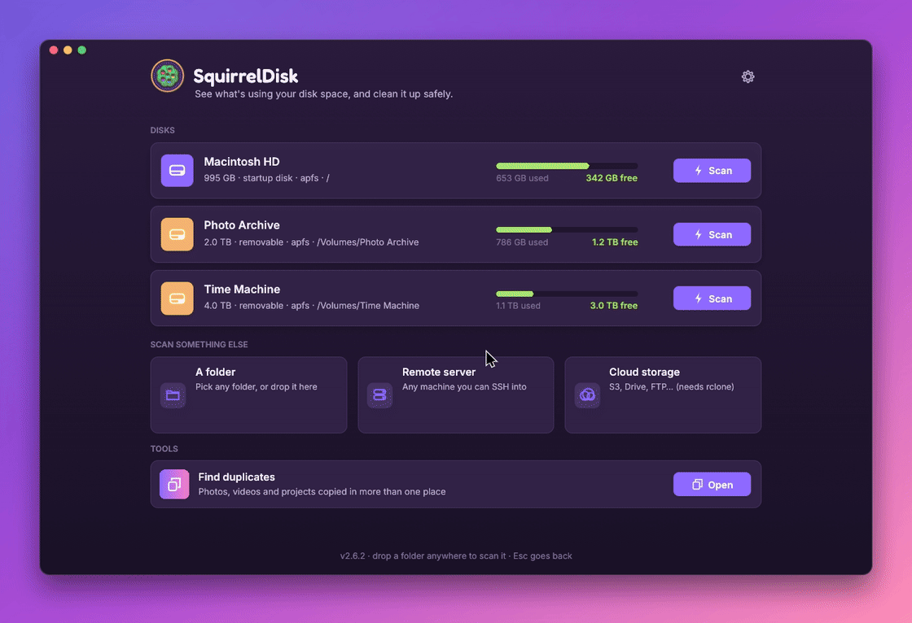
</p>

## Download

| Platform | Download |
|----------|----------|
| macOS 11 or later (Apple silicon and Intel) | [SquirrelDisk-macOS.dmg](https://github.com/Randy420Marsh/squirreldisk/releases/latest/download/SquirrelDisk-macOS.dmg) |
| Windows 10 / 11 | [Installer (.msi)](https://github.com/Randy420Marsh/squirreldisk/releases/latest/download/SquirrelDisk-Windows.msi) · [Portable (.exe)](https://github.com/Randy420Marsh/squirreldisk/releases/latest/download/squirreldisk-x86_64-pc-windows-msvc.exe) |
| Linux (x86_64), any distribution | [AppImage](https://github.com/Randy420Marsh/squirreldisk/releases/latest/download/SquirrelDisk-x86_64.AppImage) · [Archive (.tar.gz)](https://github.com/Randy420Marsh/squirreldisk/releases/latest/download/SquirrelDisk-Linux-x86_64.tar.gz) |
| Ubuntu 24.04 / 26.04 | [24.04 (.deb)](https://github.com/Randy420Marsh/squirreldisk/releases/latest/download/SquirrelDisk-Ubuntu-24.04-amd64.deb) · [26.04 (.deb)](https://github.com/Randy420Marsh/squirreldisk/releases/latest/download/SquirrelDisk-Ubuntu-26.04-amd64.deb) |
| Linux (arm64), any distribution | [AppImage](https://github.com/Randy420Marsh/squirreldisk/releases/latest/download/SquirrelDisk-aarch64.AppImage) · [Archive (.tar.gz)](https://github.com/Randy420Marsh/squirreldisk/releases/latest/download/SquirrelDisk-Linux-aarch64.tar.gz) |
| Raspberry Pi OS / Debian 13 (arm64) | [Package (.deb)](https://github.com/Randy420Marsh/squirreldisk/releases/latest/download/SquirrelDisk-Debian-trixie-arm64.deb) |
| Arch Linux | [Package (.pkg.tar.zst)](https://github.com/Randy420Marsh/squirreldisk/releases/latest/download/SquirrelDisk-Arch-x86_64.pkg.tar.zst) |
| Android 11 or later (arm64, exploratory) | [APK](https://github.com/Randy420Marsh/squirreldisk/releases/latest/download/SquirrelDisk-Android-arm64.apk) |

Every build is on the [releases page](https://github.com/Randy420Marsh/squirreldisk/releases), made by [GitHub Actions](.github/workflows/release.yml) from the tagged source, with a `SHA256SUMS` file to check the downloads against. The builds are not signed, so macOS and Windows warn the first time (see below). The newest build of `main` is the [`dev` pre-release](https://github.com/Randy420Marsh/squirreldisk/releases/tag/dev). SquirrelDisk never updates itself: download a new release when you want one. The AppImage also works with AppImageUpdate and Gear Lever, which fetch new releases from this fork when you ask them to.

<details>
<summary>macOS says the app can't be opened</summary>

SquirrelDisk is not signed with an Apple developer ID, so macOS asks for confirmation the first time.

1. Open SquirrelDisk once and close the warning.
2. Go to **System Settings → Privacy & Security**, scroll down and click **Open Anyway** next to the SquirrelDisk message, then confirm.

If macOS reports the app as damaged, run this in Terminal and open it again:

```bash
xattr -dr com.apple.quarantine /Applications/SquirrelDisk.app
```
</details>

<details>
<summary>Windows shows "Windows protected your PC"</summary>

Click **More info**, then **Run anyway**. For the portable `.exe` you can also right-click the file, choose **Properties**, tick **Unblock** and press **OK**.
</details>

<details>
<summary>Installing on Linux</summary>

- **AppImage:** `chmod +x SquirrelDisk-x86_64.AppImage` (or `-aarch64` on 64-bit ARM), then run it, or tick *Allow executing file as program* in the file's properties. It works on any distribution from 2022 on (glibc 2.35 or newer): Ubuntu 22.04 and later, Linux Mint 21+, Debian 12+, Fedora 36+, openSUSE Tumbleweed and Arch. Ubuntu 20.04, Debian 11 and RHEL 9 are too old. When it runs, SquirrelDisk adds itself to the app menu with its icon (`~/.local/share/applications/squirreldisk.desktop`), unless it is in portable mode or the `.deb` is also installed. If you delete or move the AppImage, the entry is hidden until you run it again from its new place.
  - If it says FUSE is missing (`dlopen(): error loading libfuse.so.2`), install `libfuse2t64` (Ubuntu 24.04 and later) or `libfuse2`, or run it with `--appimage-extract-and-run`.
  - It can't run from a folder mounted `noexec`, such as some USB sticks and `/tmp` on hardened systems: move it to your home folder first.
  - On a Raspberry Pi, use the `.deb` below instead: it starts faster and needs no FUSE.
- **Ubuntu:** `sudo apt install ./SquirrelDisk-Ubuntu-24.04-amd64.deb` (or the 26.04 file). It adds SquirrelDisk to the app menu and the `squirreldisk` command.
- **Raspberry Pi** (64-bit Raspberry Pi OS) **and Debian 13 on arm64:** `sudo apt install ./SquirrelDisk-Debian-trixie-arm64.deb`. The window fits small screens such as the HyperPixel 4.0 (800x480), in landscape or portrait.
- **Arch:** `sudo pacman -U SquirrelDisk-Arch-x86_64.pkg.tar.zst`. To build the package yourself from a clone, run `makepkg -si` in [packaging/arch](packaging/arch).
- **Archive:** unpack it anywhere and run `SquirrelDisk/squirreldisk`.
</details>

<details>
<summary>Portable mode (Windows and Linux)</summary>

To keep everything on a USB stick or in a single folder, create an empty folder named `portable` next to the Windows `.exe`, the `.AppImage` file or the `squirreldisk` binary from the archive:

```
SquirrelDisk/
├── squirreldisk-x86_64-pc-windows-msvc.exe
└── portable/
```

SquirrelDisk then keeps its settings there instead of in your user profile, along with your cloud accounts (`rclone.conf`). If you set `RCLONE_CONFIG` yourself, that file is used instead. To carry rclone along too, put its executable in `portable/bin/`: SquirrelDisk prefers that copy over one installed on the computer.

To use a specific folder instead, set the `SQUIRRELDISK_CONFIG_DIR` environment variable. It takes priority over the `portable` folder and works on macOS too.
</details>

## Features

**The whole disk at a glance.** Every folder becomes a slice of a colourful sunburst, sized by the space it takes. The chart builds up live while the scan runs, so the big offenders show up in seconds.

**Explore by clicking.** Click a slice to zoom in, click the centre to go back. Hover any slice and the side list shows what's inside, biggest first. Tiny files are grouped so the chart stays readable, and you can open any group to see everything in it.

<p align="center">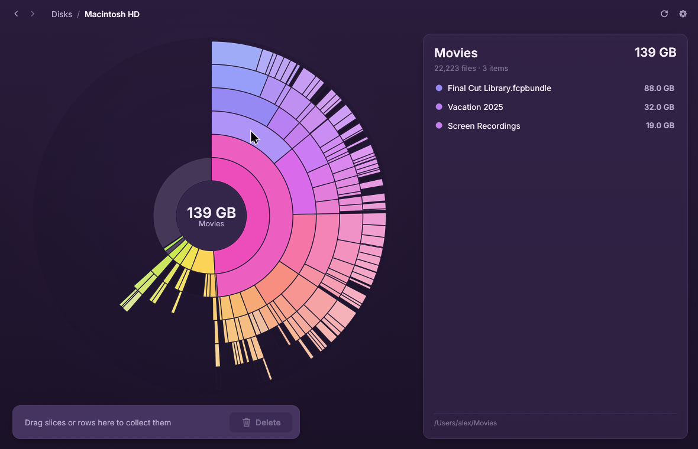</p>

**Sunburst or treemap.** Prefer boxes to rings? Switch to the treemap in Settings: every folder becomes a box inside its parent, with names and sizes, and everything else works the same way.

<p align="center">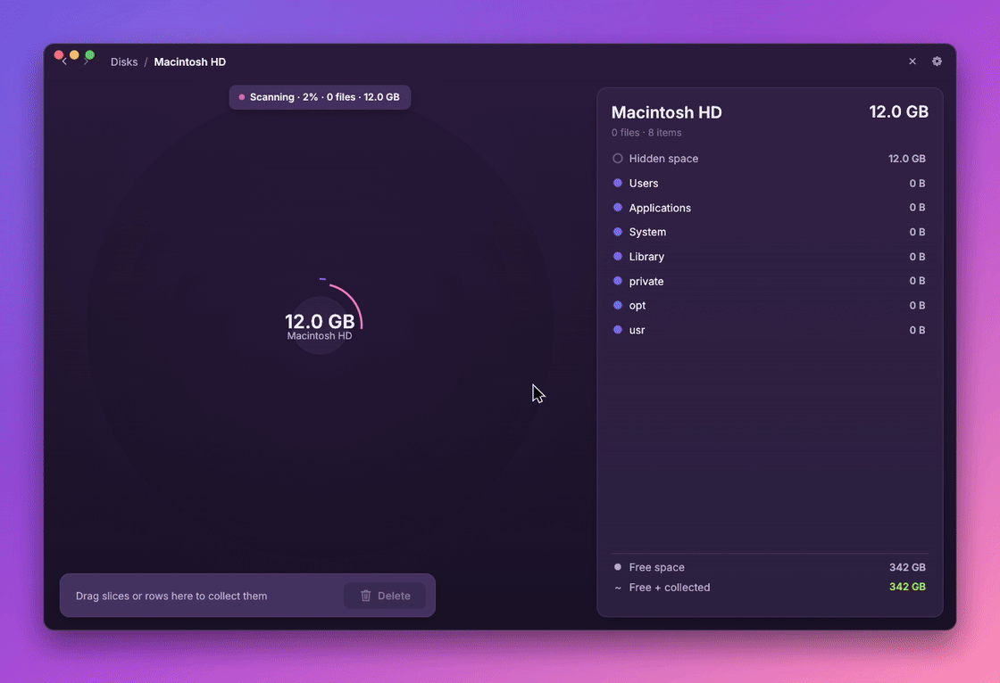</p>

**Fits any window.** The whole interface scales with the window: shrink it to a corner of the screen or stretch it across a 4K monitor, and text, buttons and the chart grow or shrink to fit. Ctrl + and Ctrl − (⌘ on macOS) make everything bigger or smaller on top of that, and Ctrl 0 goes back to normal. Your choice is remembered.

<p align="center">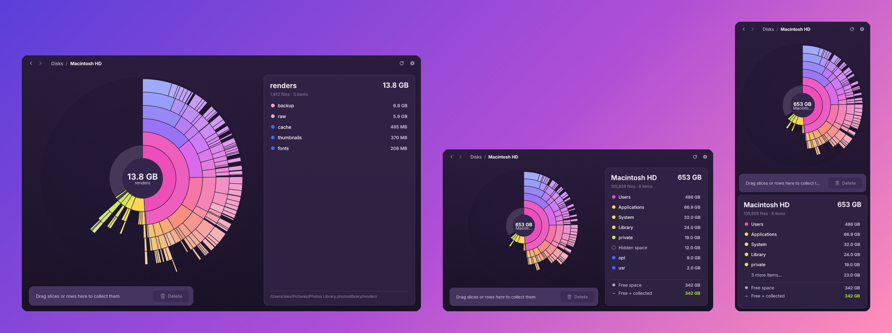</p>

**Collect, then clean up.** Drag slices or list rows into the collector at the bottom. When you're ready, move everything to the Trash, delete it for good, or copy it to an external drive or to the cloud first. A progress view keeps you posted, with a little celebration at the end.

<p align="center">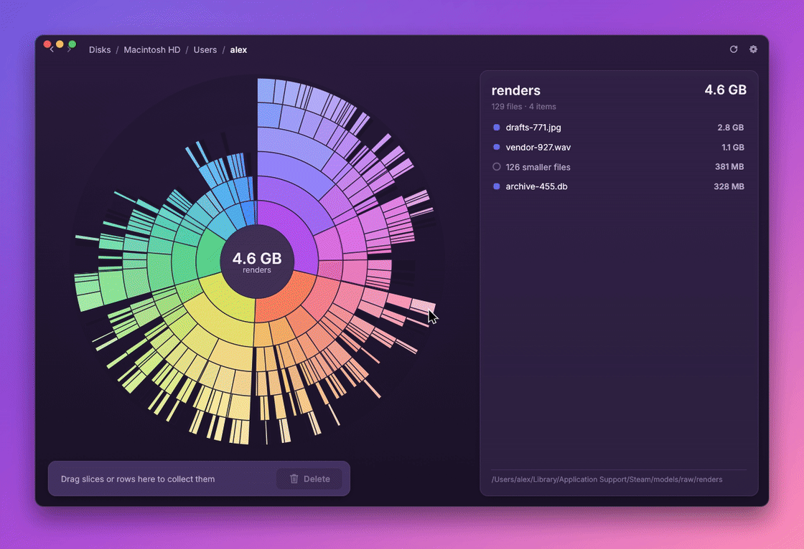</p>

**Find duplicates.** A tool on the home screen finds identical files across folders, disks, servers and cloud storage, compared by content, so renamed copies are found too. One copy of every set is always kept.

<p align="center">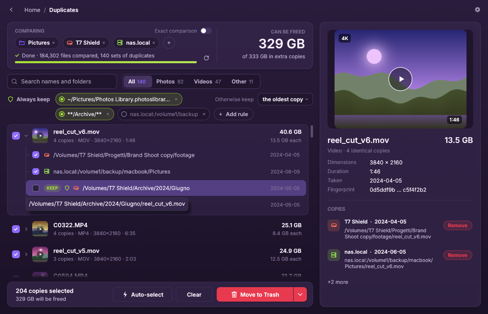</p>

**Secure erase.** When you delete for good, you can have every file overwritten three times with zeros, ones and random data (DoD 5220.22-M) before it's removed. On SSDs some old data can survive; full-disk encryption protects it completely.

**Safe by design.** System folders, your home folder, whole drives and other essential locations are protected. App and settings folders ask for an extra confirmation before anything happens. Programs, scripts and shortcuts found in a scan are never run: opening one shows it in your file manager instead.

**Accurate numbers.** SquirrelDisk shows the space files really take on disk. Files that live only in the cloud (iCloud, Dropbox, Google Drive, OneDrive) count as zero, and linked folders are counted once.

**Always up to date.** Delete something in Finder, Explorer or your file manager and the chart updates on its own.

**Servers, shares and cloud storage too.** Scan any machine you can reach over SSH. Windows shares, NAS boxes and Samba servers can be scanned directly over SMB 1, 2 or 3, encrypted with SMB 3, and mounted shares (SMB, NFS) appear on the home screen next to your disks. S3 buckets, Google Drive, Dropbox, FTP, SMB and many more cloud services work through [rclone](https://rclone.org): install rclone yourself, then add, edit and remove your accounts right from the app.

**Right from your folders.** Turn on "Folder menu" in Settings and right-clicking a folder offers "Scan with SquirrelDisk": in Finder's Quick Actions on macOS, in Explorer on Windows (under "Show more options" on Windows 11), and in Dolphin, Nemo, Nautilus (Scripts) or any file manager's "Open with" on Linux.

**From the terminal too.** `squirreldisk <folder>` opens the app on that folder, and `squirreldisk scan <folder>` prints the biggest items without opening a window, as a tree (`--depth`, `--top`) or as JSON (`--json`) for scripts. The Windows installer puts the command on your PATH; on macOS and Linux SquirrelDisk sets it up on first launch when it can, or from Settings → Command-line tool.

```
$ squirreldisk scan ~/Projects --depth 2 --top 3
/home/me/Projects  48.2 GB · 912,044 files · 3.1s

  21.4 GB   44%  squirreldisk/
  19.8 GB   41%  ├─ target/
   1.2 GB    2%  ├─ node_modules/
   402 MB    1%  └─ … 38 more
  12.0 GB   25%  website/
  …
```

**Light on your machine.** The app is a single file of about 12 MB, starts instantly, and maps millions of files with a small amount of memory. It runs smoothly on older computers too.

**Speaks your language.** SquirrelDisk is available in 26 languages, including English, 简体中文, हिन्दी, Español, Français, العربية, Português, Русский, Deutsch, 日本語, 한국어, Italiano and Suomi. It picks your system language automatically, and you can change it in Settings.

**Make it yours.** Seven colour themes, optional sound effects, and an adjustable chart depth.

<p align="center">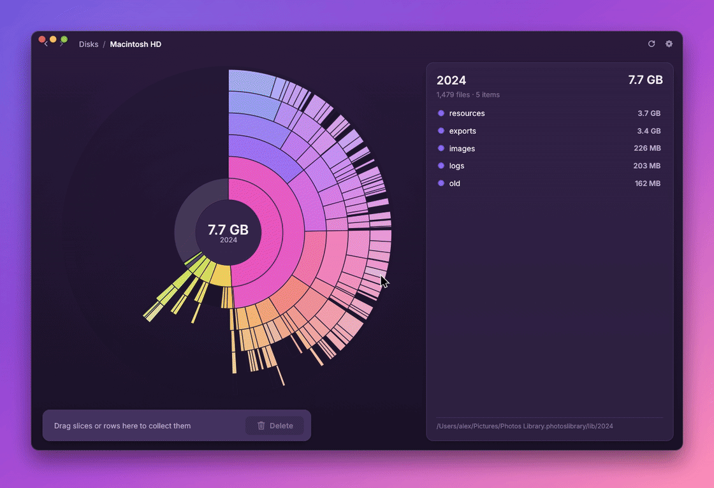</p>

## Screenshots

<p align="center">
  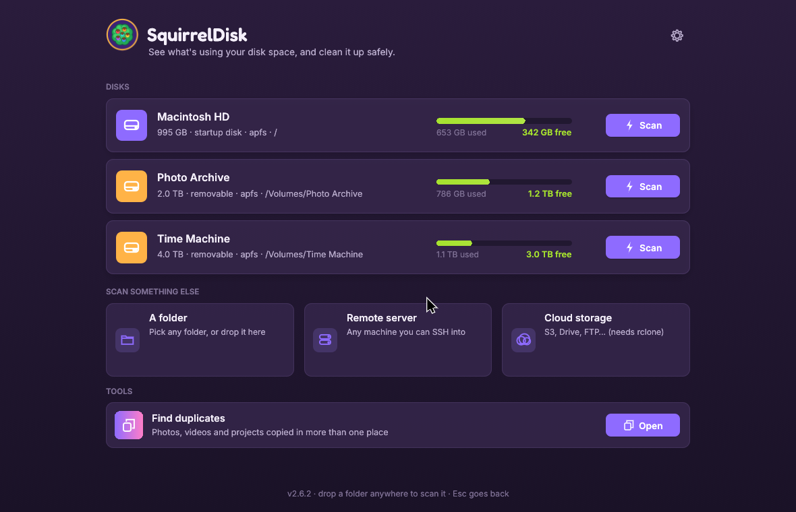
  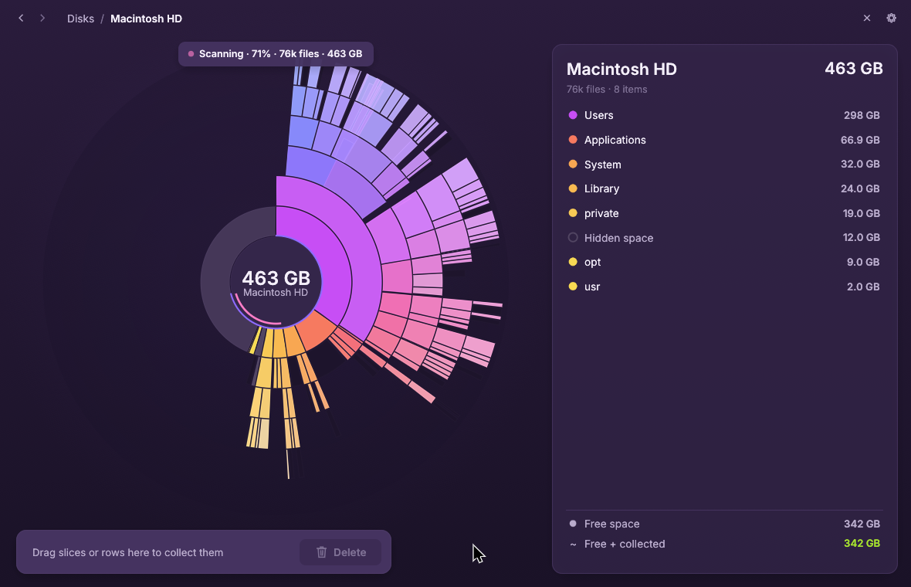
  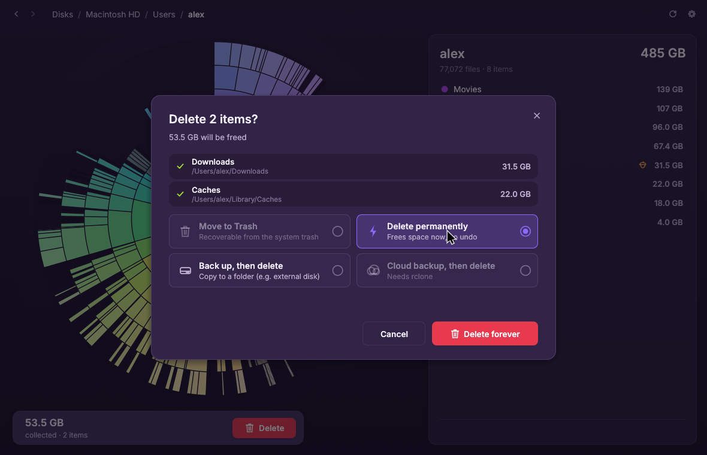
  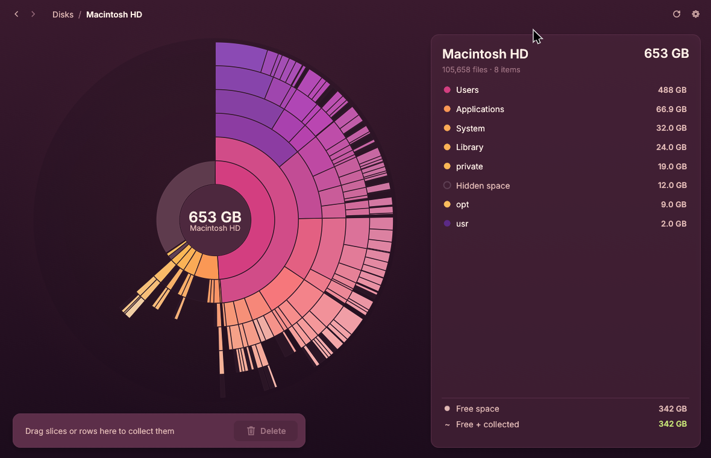
  
  
</p>

## Privacy

This fork sends nothing anywhere. There is no sponsor banner, no analytics, no crash reporting and no update check, and the app never downloads anything by itself. The only connections it makes are the ones you ask for: an SSH scan or backup to a server you name, and rclone talking to the cloud accounts you set up. [build.md](build.md#5-network-policy) shows how to check this yourself.

## Issues

Report bugs and suggest ideas in this fork's [issues](https://github.com/Randy420Marsh/squirreldisk/issues). Problems that also happen in the original SquirrelDisk can go [upstream](https://github.com/adileo/squirreldisk/issues).

## Tested platforms

Every push to `main` runs clippy, the tests (including the layout tests in landscape and portrait) and the headless build on each platform below ([ci.yml](.github/workflows/ci.yml)), and builds every package ([release.yml](.github/workflows/release.yml)). Each build job runs `squirreldisk --version` on what it made: the `.deb` and Arch packages after installing them, the macOS app and the AppImage as built, and the Android APK's signature is checked. When every package builds, they replace the [`dev` pre-release](https://github.com/Randy420Marsh/squirreldisk/releases/tag/dev). A `v*` tag publishes them as a release.

Last full run: commit `dbbd6f2` on 2026-10-23. All 6 test jobs and all 8 desktop package builds passed (Android was added to CI after that).

| Platform | Tested on every push | Release packages |
|----------|----------------------|------------------|
| Ubuntu 24.04, x86_64 | ✓ (and the third-party license list) | `.deb`; the AppImage and `.tar.gz` are built in an Ubuntu 22.04 container, so they run on older systems too |
| Ubuntu 26.04, x86_64 | ✓ | `.deb` |
| Ubuntu 24.04, arm64 | ✓ | AppImage, `.tar.gz` (built in Ubuntu 22.04) |
| Debian 13 (trixie), arm64 | built in a Debian container | `.deb` for Raspberry Pi OS |
| Arch Linux, x86_64 | ✓ in an Arch container | `.pkg.tar.zst` |
| macOS (Apple silicon runner) | ✓ | universal `.dmg` (Apple silicon and Intel) |
| Windows (latest runner), x86_64 | ✓, plus the command-line shim and the MSI | `.msi`, portable `.exe` |
| Android 11 or later, arm64 | built only; tried by hand (below) | `.apk` |

Tried by hand as well: Ubuntu 24.04 on X11 (the main development machine), small screens down to 360x780 in portrait and 800x480 in landscape on a nested X server, SMB 1, 2 and 3 (with SMB 3 encryption) against local Samba test servers, and the Android build on the Android 16 emulator and on a OnePlus phone. The Android version is exploratory: it scans local storage and SMB shares, without SSH, cloud storage or the Trash.

## Build from source

With [Rust](https://rustup.rs) installed:

```bash
cargo run --release
```

What each build needs:

| For | Tools and libraries |
|-----|---------------------|
| Every build | Rust stable (developed with 1.99) via [rustup](https://rustup.rs); `cargo` fetches the crates listed in `Cargo.lock` |
| Linux | `build-essential pkg-config libasound2-dev libxkbcommon-dev libwayland-dev libx11-dev` on Debian and Ubuntu, `base-devel rust alsa-lib libxkbcommon libglvnd` on Arch. At run time: an OpenGL driver (it falls back to CPU drawing) and `xdg-desktop-portal` for the folder picker |
| macOS | Xcode command-line tools; `rustup target add aarch64-apple-darwin x86_64-apple-darwin` for the universal app |
| Windows | Visual Studio Build Tools (MSVC); for the installer, the .NET SDK and [WiX](https://wixtoolset.org) 5 (`dotnet tool install --global wix --version 5.0.2`) |
| AppImage | [scripts/build-appimage.sh](scripts/build-appimage.sh) downloads `appimagetool`, or set `APPIMAGETOOL` to a copy you have |
| `.deb` / Arch package | `dpkg-deb` ([scripts/package-deb.sh](scripts/package-deb.sh)) / `makepkg` ([packaging/arch](packaging/arch)) |
| Android | Android SDK with platform 36 and build-tools, the NDK, a JDK (Android Studio's works) and `rustup target add aarch64-linux-android`; see [scripts/build-android.sh](scripts/build-android.sh) |
| Optional | `rclone` for cloud storage and `ssh` for remote scans, both at run time; Python 3 for [scripts/third-party-licenses.py](scripts/third-party-licenses.py); Xephyr and `python3-pil` for the small-screen screenshots |

See [build.md](build.md) for the headless agent, packaging, the tests, and how to check that the build makes no network requests. [DEVELOPMENT.md](DEVELOPMENT.md) covers the workflow: the checks before a commit, layout testing at small sizes and in portrait, and the current state of work.

## How this fork is made

The changes in this fork were written with the help of an AI coding assistant (Claude Code) and reviewed by the fork's maintainer. Every change is in the git history, the tests run on every push, and fixed bugs are written up with their tests in [BUGS.md](BUGS.md).

**Version 2.6.2 in numbers.** Everything from merging upstream SquirrelDisk 2.6.1 to this release was made in one Claude Code session with Claude Opus 5.5:

| | |
|-|-|
| Time | about 9 hours, 2026-10-22 evening to 2026-10-23 morning (about 6.5 hours of active work) |
| Model calls | 1,220 |
| Tokens written by the model | 1.04 million |
| Tokens read | 109.6 million: 106.2 million from the prompt cache, 3.4 million newly cached and about 2,400 uncached |
| Result | 11 commits: SMB 1/2/3 with encryption, small screens and touch, Android, packages for six Linux flavours, landscape and portrait layout tests, CI on every platform and the license viewer |

Most of the tokens read are the same project context being re-read from the cache on every step, which is why that number is so much larger than the amount written.

## License

[AGPL-3.0](LICENSE). SquirrelDisk is © Adileo Barone. This repository is a
**modified version**: the changes, with dates, are listed in
[NOTICE.md](NOTICE.md). The complete source of every build of this fork is
here, at <https://github.com/Randy420Marsh/squirreldisk>, under the same
license.

The fonts and Rust crates built into the app are under their own permissive
licenses (MIT, Apache 2.0, BSD, Zlib, OFL and similar), all compatible with the
AGPL. Their notices are in
[THIRD-PARTY-LICENSES.txt](THIRD-PARTY-LICENSES.txt), which ships with every
package, and in the app under Settings → Licenses.
